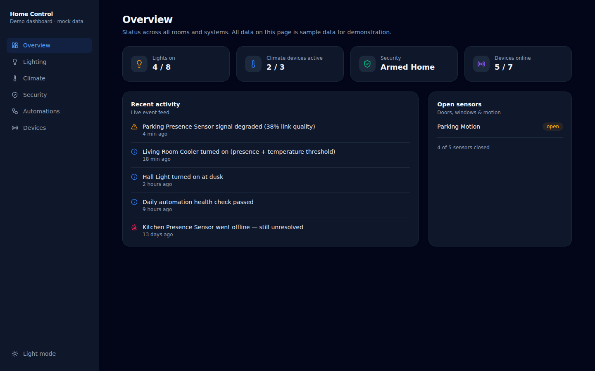
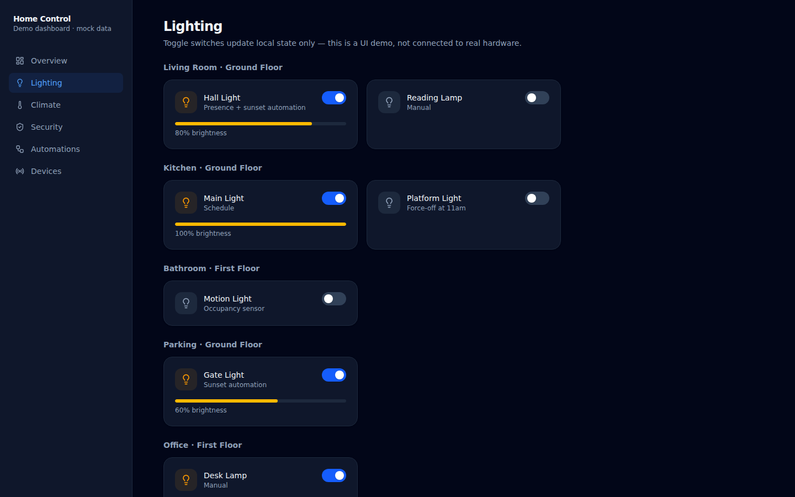
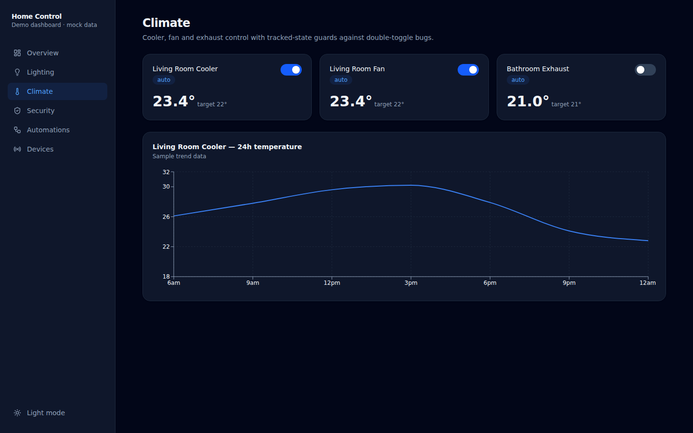
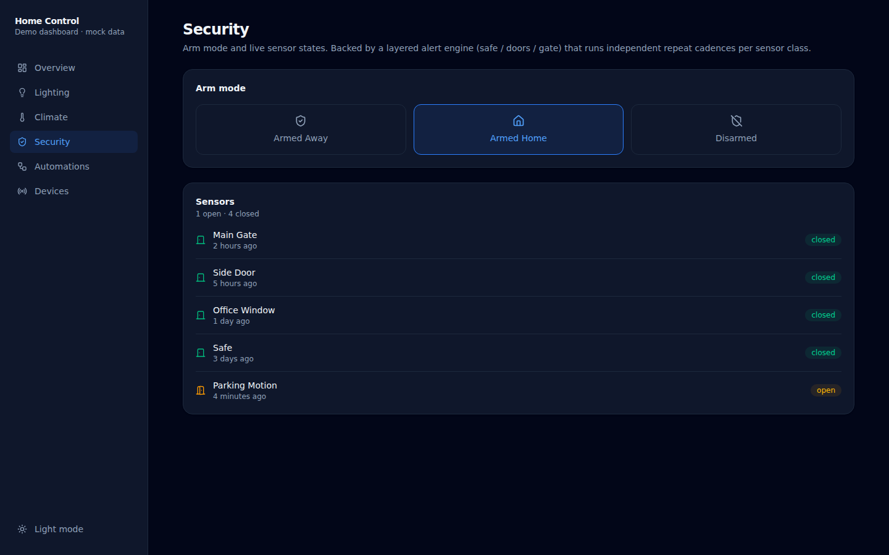
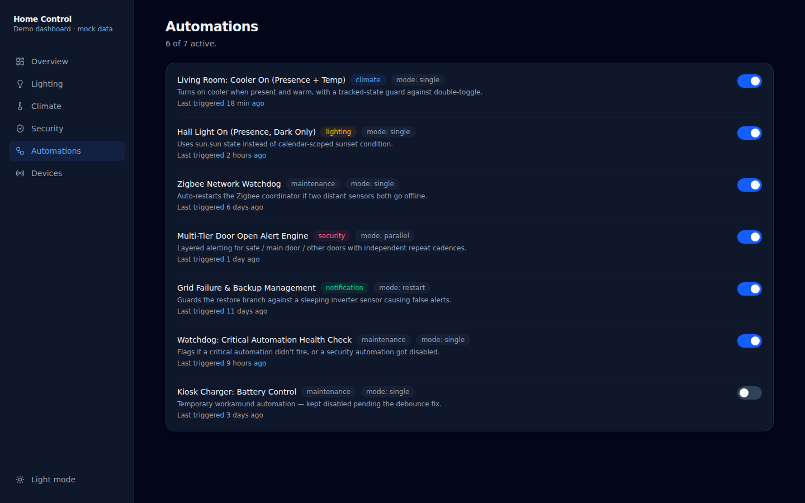
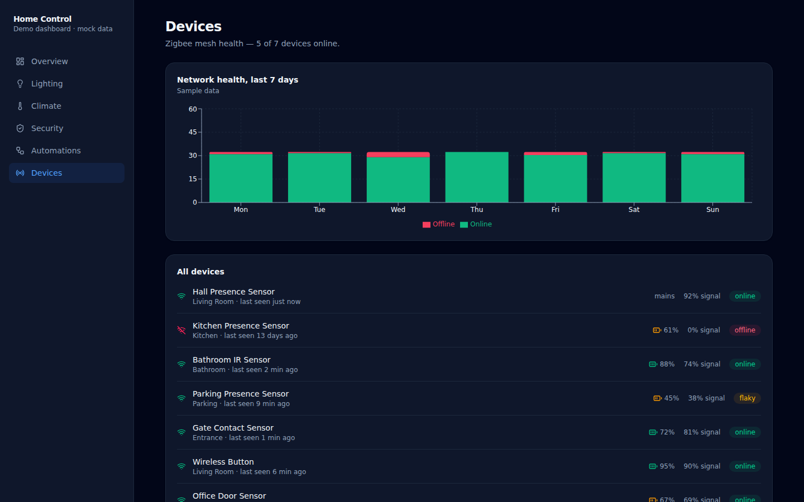

# Home Control — Smart Home Dashboard (React)

A standalone React + TypeScript dashboard UI for a multi-room smart home, built to demonstrate frontend architecture and design for a real Home Assistant-backed home automation system. Runs entirely on realistic **mock data** — no live connection, no credentials, nothing to configure.

> This is a UI/UX portfolio piece, not a Home Assistant plugin. It's a separate app that mirrors the shape of a real smart-home control panel (lighting, climate, security, device health, automations) so the dashboard can be shown, shared, and iterated on independently of the actual home it's modeled after.



## Stack

- **React 19** + **TypeScript**
- **Vite** for build tooling
- **React Router** (`HashRouter`, so it deploys cleanly to GitHub Pages with no server config)
- **Tailwind CSS v4** for styling, with a class-based dark mode toggle
- **Recharts** for the temperature trend and device-health charts
- **lucide-react** for icons

## Features

- **Overview** — at-a-glance stats (lights on, climate active, security mode, devices online), a live activity feed, and open-sensor list
- **Lighting** — per-room light cards with toggle + brightness, grouped by room/floor
- **Climate** — cooler/fan/exhaust control cards with a 24h temperature trend chart
- **Security** — arm-mode switcher (Away / Home / Disarmed) and live sensor list (doors, windows, safe, motion)
- **Automations** — list of automations with category badges, execution mode, last-triggered time, and enable/disable toggles
- **Devices** — Zigbee mesh health: battery/signal per device, online/offline status, and a 7-day network health chart

All toggles update local React state only (`useState`) — nothing persists or calls a real API, by design, so the repo is 100% safe to run, fork, and demo without any backend.

## Screenshots

| Lighting | Climate |
|---|---|
|  |  |

| Security | Automations |
|---|---|
|  |  |

| Devices |
|---|
|  |

## Running locally

```bash
npm install
npm run dev
```

Then open the printed local URL. Build for production with:

```bash
npm run build
npm run preview
```

## Project structure

```
src/
├── types.ts              # Shared TypeScript types for every entity kind
├── data/mockData.ts       # All sample data lives here — swap this out to repoint at real data
├── components/            # Reusable UI: Card, Badge, ToggleSwitch, Layout (sidebar + routing shell)
└── pages/                 # One component per route: Overview, Lighting, Climate, Security, Automations, Devices
```

## Design notes

- **Mock data lives in one file** (`src/data/mockData.ts`), typed against shared interfaces in `types.ts` — swapping this dashboard to talk to a real API later would mean replacing that one file's data source with a fetch/WebSocket hook, without touching any component.
- **Dark mode** uses Tailwind v4's `@custom-variant` with a `.dark` class toggle on `<html>`, rather than relying solely on `prefers-color-scheme`, so the in-app toggle actually works.
- **Routing** uses `HashRouter` specifically so the built app can be dropped onto GitHub Pages (or any static host) with zero server-side rewrite rules.

## Why this exists

This dashboard models the UI layer for a real multi-room Home Assistant deployment — Zigbee device mesh, layered security automations, climate control with race-condition guards, solar/grid failover, and self-healing network watchdogs. The automation logic and architecture for that system are documented in a companion repo: `smart-home-automation-engine`. This repo focuses purely on the frontend: how that system's state would be presented and controlled in a clean, componentized React UI.
